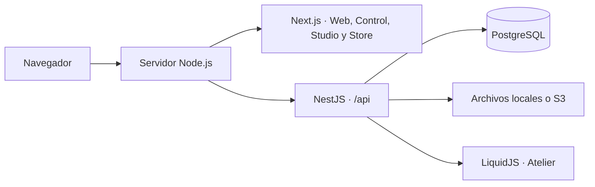

# Monolito modular de Vendelier

La primera entrega del plan maestro adaptativo consolida Web, Control, Studio, Store y la API en un proceso Node.js. El monorepo conserva pnpm y Turborepo para separar los paquetes y ejecutar compilaciones y pruebas por dependencia.

## Servidor y persistencia

- `apps/vendelier` contiene las rutas de Next.js y el único arranque de la aplicación. La entrada `server.mjs` envía `/api` a Nest y las demás rutas y recursos a Next. Nest se inicializa una vez y usa el mismo listener HTTP.
- `apps/api` conserva los contratos REST, la autorización y las reglas comerciales. El paquete también permite inicializar Nest de forma aislada para las pruebas. Next usa rutas relativas para enlaces, llamadas a la API y medios.
- `packages/database` conserva PostgreSQL, Prisma, las migraciones y los roles. Las operaciones por empresa siguen resolviendo el contexto a partir de la sesión o del slug publicado y aplican RLS con contexto limitado a la transacción. El cambio de servidor reutiliza las bases y los archivos locales existentes.
- Para ejecutar el monolito en producción, conserva el workspace y los artefactos de `pnpm build`, incluidos `.next`, los paquetes compilados y `themes/atelier`. Se necesita un entorno que ejecute el proceso Node de forma persistente. [Servidor personalizado de Next.js](https://nextjs.org/docs/app/guides/custom-server)

## Configuración del proceso

| Variable | Uso |
| --- | --- |
| `VENDELIER_HOST` | Dirección de escucha. Por defecto `127.0.0.1`. Usa `0.0.0.0` en un contenedor si el servicio debe aceptar conexiones de su red. |
| `VENDELIER_PORT` | Puerto de la aplicación. Por defecto `3000`. |
| `VENDELIER_ORIGIN` | Origen HTTP(S) externo, por ejemplo `https://vendelier.example.com`. Configúralo si un proxy termina HTTPS o cambia el host. La API lo usa para validar el encabezado `Origin` de las escrituras. |
| `SESSION_COOKIE_SECURE` | Usa `true` con HTTPS para que la cookie de sesión se envíe solo por conexiones seguras. |
| `DATABASE_URL`, `SESSION_SECRET`, `DEMO_ADMIN_TOKEN`, `MEDIA_*` | Conexión del rol de la aplicación, secretos y configuración del almacenamiento. Consulta los valores locales de referencia en `.env.example`. |

En desarrollo, `pnpm dev` compila las dependencias de la API y habilita recarga de cambios en Next. Reinicia el proceso tras modificar el backend o las plantillas Liquid. Para producción, ejecuta `pnpm build` y `pnpm start`. La salud está en `/api/health` y Swagger en `/api/docs`.

## Prueba inicial del motor de temas

`packages/theme-engine` carga la plantilla y los parciales propios de `themes/atelier` desde un mapa fijo. La caché guarda plantillas analizadas. Cada render toma un contexto nuevo con nombre público, colores validados, URLs internas de medios y hasta 24 productos de la empresa. La salida HTML escapa el texto y su CSP permite únicamente las imágenes internas y la hoja de estilos verificada por hash. [Modelo de seguridad de LiquidJS](https://liquidjs.com/tutorials/security-model.html)

| Ruta | Datos y acceso |
| --- | --- |
| `/api/store/<slug>/atelier` | Catálogo público de la tienda publicada. Usa el tema publicado o los valores predeterminados. |
| `/api/studio/appearance/storefront/atelier` | Borrador guardado y catálogo de la sesión de Studio. Se sirve con `private, no-store`, `noindex` y CSP `sandbox`. |

La prueba aplica aislamiento del documento mediante CSP en el origen único. El plan conserva como pendientes la vista previa temporal en otro origen, las secciones y bloques editables por esquema, el historial de revisiones y la publicación de Atelier como catálogo principal. La compra sigue en `/tiendas/<slug>` y usa los contratos de catálogo, checkout e inventario del monolito.

## Verificación

`pnpm test:monolith` arranca una compilación de producción y verifica por el mismo puerto las cuatro superficies, recursos de Next, salud, OpenAPI y el acceso al borrador. El flujo HTTP con `API_FLOW_TEST=1` comprueba con PostgreSQL la publicación, la separación entre dos empresas, el acceso a imágenes privadas y la distinción entre catálogo público y borrador Liquid. [Comandos de verificación](../../README.md#verificación)
