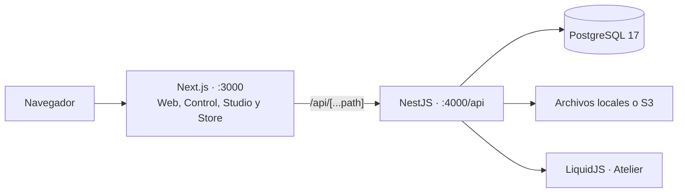

# Arquitectura de dos aplicaciones (Frontend y Backend)

Vendelier separa la capa web y la API en **dos aplicaciones independientes** dentro del monorepo (`pnpm` + Turborepo):

- **Frontend (`apps/vendelier`, `@vendelier/app`)**: Aplicación Next.js 16 (App Router) que sirve Web, Control, Studio y Store, e incluye un proxy dinámico en `app/api/[...path]/route.ts` hacia el backend.
- **Backend (`apps/api`, `@vendelier/api`)**: Aplicación NestJS standalone bajo el prefijo global `/api` que concentra reglas comerciales, autenticación, PostgreSQL/RLS, almacenamiento multimedia y renderizado LiquidJS.

## Servidores y persistencia

- `apps/vendelier` ejecuta Next.js directamente (`next dev --turbopack` en desarrollo y `next start` en producción). El Route Handler `app/api/[...path]/route.ts` reenvía en tiempo de ejecución todas las solicitudes `/api/*` a `API_INTERNAL_URL` (por defecto `http://127.0.0.1:4000`), preservando cookies, cabeceras `Authorization`/`Origin`, respuestas binarias (`image/webp`) y HTML de Atelier.
- `apps/api` (`src/main.ts`) arranca NestJS de forma independiente en `API_HOST:API_PORT` (por defecto `127.0.0.1:4000`) con `globalPrefix: "api"` (configurable vía `API_PREFIX`) y validación de `Origin` y CORS para el frontend. El paquete también exporta `createApp()` para las pruebas automatizadas.
- `packages/database` conserva PostgreSQL, Prisma 7, las migraciones y los roles. Las operaciones por empresa resuelven el contexto a partir de la sesión o del slug publicado y aplican RLS con contexto limitado a la transacción (`withTenant`).
- Para ejecutar en producción, ejecuta `pnpm build` y luego `pnpm start` (que inicia ambos procesos vía Turborepo), o despliega `@vendelier/app` y `@vendelier/api` por separado configurando `API_INTERNAL_URL` en el frontend y `VENDELIER_ORIGIN` / `API_CORS_ORIGINS` en el backend.

## Configuración de variables de entorno

| Variable | App | Uso |
| --- | --- | --- |
| `VENDELIER_HOST` | Frontend | Dirección de escucha de Next.js en producción. Por defecto `127.0.0.1`. |
| `VENDELIER_PORT` | Frontend | Puerto de Next.js en producción. Por defecto `3000`. |
| `API_INTERNAL_URL` | Frontend | URL base del backend usada en runtime por `/api/[...path]`. Por defecto `http://127.0.0.1:4000`. |
| `API_HOST` | Backend | Dirección de escucha de NestJS. Por defecto `127.0.0.1`. |
| `API_PORT` | Backend | Puerto de NestJS. Por defecto `4000`. |
| `API_CORS_ORIGINS` | Backend | Lista separada por comas de orígenes permitidos por CORS. |
| `VENDELIER_ORIGIN` | Backend | Origen HTTP(S) público del frontend (ej. `https://vendelier.example.com`). Se usa para validar el encabezado `Origin` en escrituras. |
| `SESSION_COOKIE_SECURE` | Backend | Usa `true` con HTTPS para que la cookie de sesión se envíe solo por conexiones seguras. |
| `DATABASE_URL`, `SESSION_SECRET`, `DEMO_ADMIN_TOKEN`, `MEDIA_*` | Backend | Conexión del rol de aplicación, secretos y almacenamiento multimedia. Consulta `.env.example`. |

En desarrollo, `pnpm dev` inicia Next.js y NestJS en paralelo con recarga automática. La salud está en `/api/health` y Swagger en `/api/docs`.

## Prueba inicial del motor de temas

`packages/theme-engine` carga la plantilla y los parciales propios de `themes/atelier` desde un mapa fijo. La caché guarda plantillas analizadas. Cada render toma un contexto nuevo con nombre público, colores validados, URLs internas de medios y hasta 24 productos de la empresa. La salida HTML escapa el texto y su CSP permite únicamente las imágenes internas y la hoja de estilos verificada por hash. [Modelo de seguridad de LiquidJS](https://liquidjs.com/tutorials/security-model.html)

| Ruta | Datos y acceso |
| --- | --- |
| `/api/store/<slug>/atelier` | Catálogo público de la tienda publicada. Usa el tema publicado o los valores predeterminados. |
| `/api/studio/appearance/storefront/atelier` | Borrador guardado y catálogo de la sesión de Studio. Se sirve con `private, no-store`, `noindex` y CSP `sandbox`. |

La prueba aplica aislamiento del documento mediante CSP en el origen compartido. El plan conserva como pendientes la vista previa temporal en otro origen, las secciones y bloques editables por esquema, el historial de revisiones y la publicación de Atelier como catálogo principal. La compra sigue en `/tiendas/<slug>` y usa los contratos de catálogo, variantes, checkout e inventario de la API.

## Verificación

`pnpm test:integration` (`tests/integration.test.mjs`) arranca ambos servidores en puertos efímeros (`@vendelier/api` y `@vendelier/app` en producción) y verifica las cuatro superficies, recursos de Next.js, salud, OpenAPI, acceso al borrador y reenvío `/api/*`. El flujo HTTP con `API_FLOW_TEST=1` comprueba con PostgreSQL la publicación, la separación entre dos empresas, el acceso a imágenes privadas y la distinción entre catálogo público y borrador Liquid. [Comandos de verificación](../../README.md#verificación)
